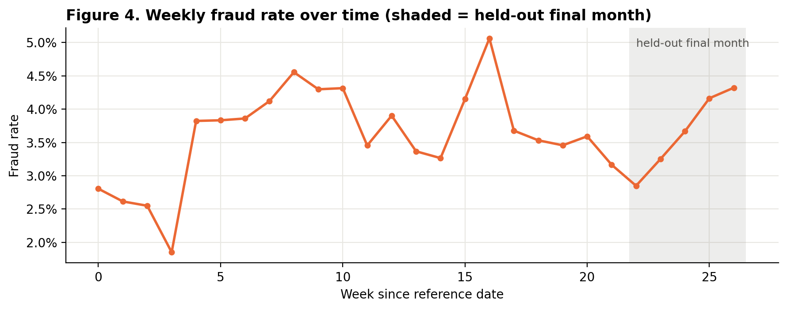

# Catching More Fraud Dollars with Limited Review Capacity

**Capstone Project · MS in Data Analytics, Maryville University · Gretchen Kolthoff**

A machine learning project that helps a card issuer's fraud team decide which transactions to review first, so a small team catches as many fraud dollars as possible.

**Contents:** [Problem](#the-business-problem) · [Data and key trends](#what-the-data-shows) · [Models](#models-baseline-vs-gradient-boosting) · [Dashboard](#dashboard-in-progress) · [Reflection](#reflection) · [Code](#code)

---

## The business problem

A fraud team can only review a small share of transactions each day, and rule-based screening fills that queue with legitimate purchases while missing high-dollar fraud.

**Problem statement:** Build a model that ranks card-not-present transactions by fraud risk so that, when analysts review only the riskiest **2%** of transactions, they catch as many **fraud dollars** as possible. Success is measured on a held-out final month, compared against a simple baseline model.

**Who it's for:** a fraud strategy manager (persona: *Scarlett Smith*) who sets alert thresholds, manages a fixed team of analysts, and reports fraud losses to leadership.

---

## What the data shows

**Data:** IEEE-CIS Fraud Detection dataset (Vesta Corporation, via Kaggle). 590,540 online card transactions over about six months, with a fraud label for each one.

**Key trends:**

- **Fraud is rare.** Only **3.5%** of transactions are fraud. A model that approves everything would be 96.5% accurate and catch nothing, so accuracy is the wrong way to judge success.
- **Fraud patterns change over time.** The weekly fraud rate ranged from **1.85% to 5.06%**, so models are trained on earlier months and tested on the final month, the way they would be used in practice.
- **Risk differs sharply by segment.** One product type had an **11.7%** fraud rate versus **2.0%** for another, and transactions with device/identity data were fraudulent **7.8%** of the time versus **2.1%** without it.

---

## Models: baseline vs. gradient boosting

| Model | Fraud dollars caught (top 2% reviewed) | PR AUC | Notes |
|---|---|---|---|
| Logistic regression (baseline) | **5.4%** | 0.157 | Simple and explainable; catches mostly small-dollar fraud |
| LightGBM (untuned, early benchmark) | **35.0%** | 0.614 | Captures interactions and thresholds a linear model can't |

**What this means for the business:**

- The baseline catches about **1 in 10 fraud cases** in the review queue but only **5.4% of fraud dollars**. The fraud it finds averages about **$82**, versus **$153** across all fraud, so high-dollar fraud slips through.
- The gradient-boosted model catches about **6.5× more fraud dollars** with the same review capacity.
- Using the default 0.5 cutoff would flag **25%** of all transactions, far more than a team can review, so alerts should be set by **review capacity**, not a fixed probability.

**Next step:** tune the gradient-boosted model and weight training by transaction amount, so the model learns that missing a $5,000 fraud costs more than missing a $5 one.

---

## Dashboard (in progress)

The dashboard is being designed for the fraud manager and will answer one question: *"If my team reviews the top X% of transactions, how many fraud dollars do we catch, and how many false alarms do we review?"*

**Planned components:**

- **KPI tiles:** fraud dollars caught, alerts reviewed, and precision of the review queue
- **Review-budget curve:** fraud dollars caught at each review capacity (prototype shown above)
- **Alert table:** the riskiest transactions with the top reasons each was flagged

The charts above are the current prototypes; an interactive version is the next step.

---

## Reflection

The biggest lesson so far is that the right metric matters as much as the right model. A model can look 95% accurate while catching almost none of the fraud that actually costs money, so framing every result around **fraud dollars caught within the team's review capacity** kept the project tied to a decision a fraud manager can act on. Testing on a later month, instead of a random split, also gave a more honest picture of how the model would perform as fraud patterns shift. Next, I plan to tune the gradient-boosted model, weight it toward high-dollar fraud, and turn the prototype charts into an interactive dashboard.

---

## Code

- `data650_project2.py`: data loading, cleaning, exploratory analysis, and feature engineering
- `data650_module5_baseline.py`: logistic regression baseline and evaluation

**Tools:** Python, pandas, scikit-learn, LightGBM, matplotlib

**Data source:** IEEE Computational Intelligence Society & Vesta Corporation. (2019). *IEEE-CIS fraud detection* [Data set]. Kaggle. https://www.kaggle.com/competitions/ieee-fraud-detection

*AI use: I used Claude (Anthropic) to help write code, organize this page, and edit for clarity. All modeling decisions and interpretations are my own.*
