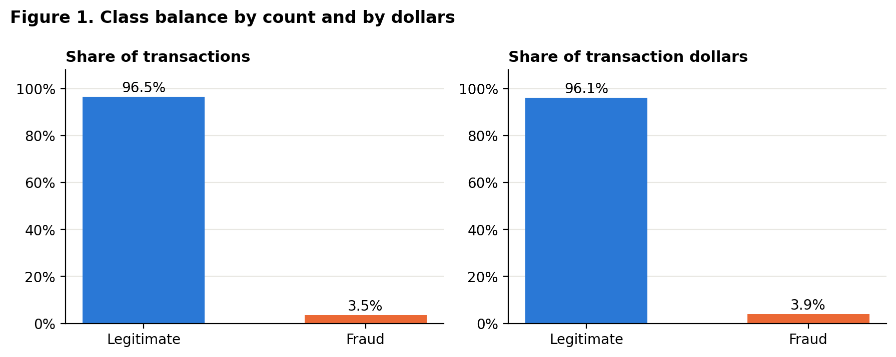
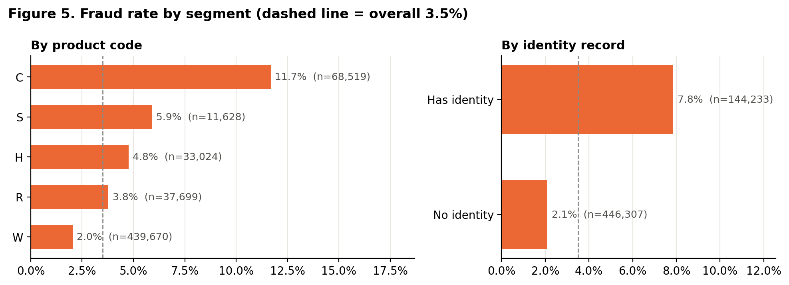
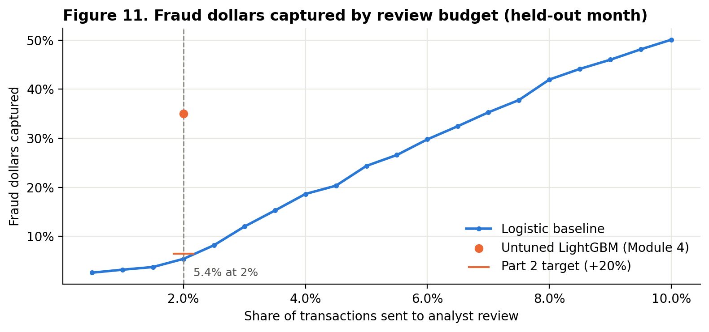
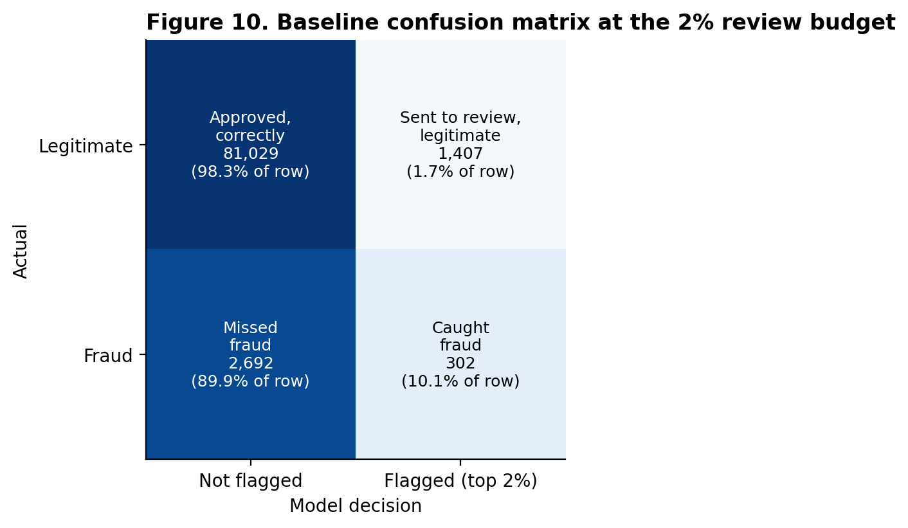

# Catching More Fraud Dollars with Limited Review Capacity

**Capstone Project · MS in Data Analytics, Maryville University · Gretchen Kolthoff**

A machine learning model that ranks card transactions by fraud risk, so a small fraud team catches as many fraud dollars as possible.

## The Business Problem

Fraud teams can only review a small share of transactions, and rule-based alerts fill that queue with legitimate purchases. **Goal:** when analysts review only the riskiest **2%** of transactions in a held-out final month, catch as many **fraud dollars** as possible, compared against a simple baseline model.

## What the Data Shows

**Data:** IEEE-CIS Fraud Detection (Vesta/Kaggle): 590,540 online card transactions over about six months.

- **Fraud is rare (3.5%)**, so accuracy is misleading: approving everything is 96.5% accurate and catches nothing.
- **Fraud shifts over time** (weekly rate of 1.85% to 5.06%), so models train on earlier months and test on the last month.
- **Risk varies by segment:** 11.7% fraud for one product type vs. 2.0% for another.

## Models

| Model | Fraud dollars caught (top 2% reviewed) | PR AUC |
|---|---|---|
| Logistic regression (baseline) | 5.4% | 0.157 |
| LightGBM (untuned) | 35.0% | 0.614 |

The baseline mostly catches small-dollar fraud (about $82 on average vs. $153 overall). The gradient-boosted model catches about **6.5× more fraud dollars** with the same review capacity. **Next:** tune it and weight training toward high-dollar fraud.

## Dashboard (In Progress)

A dashboard for the fraud manager showing fraud dollars caught, alerts reviewed, and false alarms at each review budget, plus a table of top alerts and why they were flagged. The charts above are the current prototypes.

## Reflection

The biggest lesson so far is that the right metric matters as much as the right model. A model can look 95% accurate while missing the fraud that costs the most. Measuring fraud dollars caught within the team's review capacity, and testing on a later month, kept the project tied to a real decision, while avoiding leakage. Next, I'll tune the gradient-boosted model and build the interactive dashboard. 

---

**Tools:** Python, pandas, scikit-learn, LightGBM, matplotlib, **Claude**: reviewing my modeling decisions and providing feedback; all modeling decisions and interpretations are my own.*
